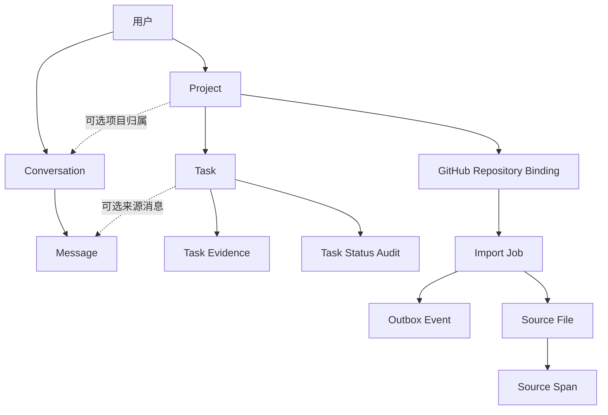
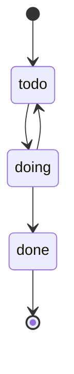

# Go-Server v1.0 需求规格与交付状态

面向开发、验收和维护。功能状态以当前注册路由、调用链、SQL Migration 和测试为依据。文末保留原 P0 设计决策及其演进。

## 1. 背景、目标与范围

Go-Server 服务于希望围绕代码仓库学习、实践和复盘的个人开发者。v1.0 提供两条可独立使用的闭环。

1. **实践任务**：注册登录，创建项目和会话，保存讨论消息，按需把消息关联为任务来源，推进任务并提交证据，最终读取任务、来源、证据和审计。
2. **源码查阅与问答**：在项目绑定 GitHub 公开仓库，发起固定 Revision 导入，等待任务成功，查阅文件和片段，并通过配置好的外部模型针对该快照提问。调用者可根据引用路径、行号和哈希复查证据。

两条闭环共享项目和用户边界。Ask 可以验证指定的会话归属，但问答不会写入会话消息，也不会自动创建实践任务。

## 2. 交付状态

- **已实现**：当前实现形成完整闭环，并有相应测试或验证路径。
- **部分实现**：存在 Schema、领域逻辑或运维基础，缺少完整产品入口或后续操作。
- **未实现**：当前没有对应业务实现。
- **延期**：作为需求保留，明确划出 v1.0。

| 模块 | 状态 | 已交付边界与验证依据 |
| --- | --- | --- |
| 用户认证 | 已实现 | 注册、bcrypt、登录和 JWT 私有路由；`internal/service/auth_service_test.go`、`internal/security/jwt_test.go`。 |
| 项目管理 | 已实现 | 创建、详情和用户分页列表；`internal/handler/project_handler_test.go`。 |
| 项目改名 | 部分实现 | `ProjectService.UpdateProjectName` 和缓存失效及回滚测试，无公开路由；`internal/service/project_cache_race_test.go`。 |
| 会话与消息 | 已实现 | 创建时可关联项目、读取会话、项目内会话分页、发送及读取消息；`internal/handler/conversation_project_list_test.go`、`internal/service/message_service_test.go`。 |
| 实践任务 | 已实现 | 创建、按项目和状态列出、版本 CAS、完成门槛；`internal/service/task_service_test.go`、`internal/handler/task_p0_test.go`。 |
| 任务证据、审计与复盘 | 已实现 | 创建草稿或正式证据、状态变更审计、聚合只读复盘；`internal/handler/task_evidence_handler_test.go`、`internal/handler/task_p0_test.go`。 |
| Redis 缓存与限流 | 已实现 | 项目详情和 GitHub 元数据缓存、Singleflight、绑定入口用户级限流、导入并发门禁；`internal/service/project_cache_race_test.go`、`internal/githubclient/governance_test.go`、`internal/ratelimit/redis_test.go`。 |
| GitHub 仓库绑定 | 已实现 | 公开性、默认分支 SHA、归属、去重、Token 和限流语义；`internal/handler/github_binding_handler_test.go`、`internal/service/github_binding_test.go`。 |
| Import Job | 已实现 | 幂等创建、固定 Revision、所有者状态查询，支持重试与终态记录；`internal/handler/import_handler_test.go`、`internal/service/import_job_concurrency_test.go`。 |
| Worker 与快照 | 已实现 | CAS、租约、重试、领取恢复、文本源码及片段的事务写入；`internal/worker/github_executor_integration_test.go`、`internal/repository/source_snapshot_test.go`。 |
| Transactional Outbox 与 Kafka | 已实现 | 创建事务、扫描和同步发送、终态后提交 Offset、重投去重；`internal/service/import_job_test.go`、`internal/publisher/publisher_test.go`、`internal/consumer/handler_integration_test.go`。 |
| DLQ 与进程恢复 | 已实现 | 永久消息错误的 DLQ、取消与过期租约恢复；`internal/consumer/kafka_dlq_integration_test.go`、`internal/consumer/shutdown_test.go`、`internal/worker/process_integration_test.go`。 |
| 源码检索 | 已实现 | 四个只读路由，按用户与项目隔离成功快照，支持字面搜索；`internal/handler/source_handler_test.go`、`internal/repository/source_retrieval_test.go`。 |
| LLM Client | 已实现 | 受配置控制的单次 Chat Completions、超时、大小限制与协议校验；`internal/llmclient/config_test.go`、`internal/llmclient/client_test.go`。 |
| AI Ask | 已实现 | 单轮检索、上下文、生成和引用校验；`internal/service/ask_evidence_test.go`、`internal/service/ask_response_test.go`、`internal/handler/ask_e2e_test.go`。 |
| 独立 Task Review | 部分实现 | `task_reviews` Migration 和 `TaskReview` 模型预留，尚无评审提交、查询或审批流程。只读复盘已实现。 |
| 项目归档/恢复、会话项目改绑、任务内容编辑与独立详情 | 延期 | 项目归档状态及有关写入保护已存在。当前路由没有这些操作，任务详情可通过列表或复盘读取。 |
| 多轮 AI、消息持久化及 Agent 扩展 | 延期 | 多轮会话、AI 消息写回、Agent Loop、Tool Runtime、MCP 和向量检索划出 v1.0。 |
| 自动 DLQ 消费与重放、前端、团队权限、复杂任务流 | 未实现 | 当前 DLQ 由维护者处理；暂无对应前端、团队权限、任务评论/依赖或自定义状态。 |

## 3. 领域模型与一致性

| 实体 | 数据规则 |
| --- | --- |
| `users`、`projects` | 用户名与邮箱分别唯一；项目由单一用户拥有，同一用户内项目名唯一。项目名为 `VARCHAR(128)`，描述可空，状态仅 `active`/`archived`，创建为 `active`。`(id, user_id)` 作为复合外键目标。 |
| `conversations`、`messages` | 会话由用户拥有，`project_id` 可空以兼容历史数据；会话项目关联须匹配用户。消息随会话存储，公开发送路径以 `user` 角色写入。消息插入和会话时间更新在同一事务。 |
| `tasks` | 按 `(project_id, user_id)` 绑定项目；`source_message_id` 可空，引用消息删除时置空。Service 确保来源消息来自同用户同项目会话。标题最多 200 字符，描述可空。任务默认 `todo`、`version=1`、`completed_at=NULL`。 |
| `task_evidence`、`task_status_audits` | 证据的任务与创建者通过复合外键关联；审计记录操作者、状态和版本前后值，对同任务目标版本去重。 |
| `repositories`、`import_jobs` | 绑定按项目、owner 和 repo 去重；导入分别通过项目用户和仓库项目复合约束限定资源，幂等键由 `(user_id, endpoint, idempotency_key)` 唯一约束保护。 |
| `outbox_events`、`source_files`、`source_spans` | Outbox 以事件 ID 和 `(job_id,event_type)` 去重。文件通过任务、用户、项目、仓库与 Revision 的复合外键限定，任务内路径唯一；片段按文件和索引唯一，行区间合法。 |

### Migration 基线

| 版本 | 作用 |
| --- | --- |
| `000001–000003` | 用户、会话、消息 |
| `000004–000006` | 项目、会话可选关联和实践任务 |
| `000007–000010` | 状态审计、任务证据、预留评审与任务列表索引 |
| `000011–000015` | 仓库、导入、租约和重试、导入状态规范化、Outbox |
| `000016–000017` | 导入结果元信息和源码文件/片段 |

版本化 SQL 是 Schema 的事实来源。应用连接 MySQL 时不会自动执行这些 SQL。维护者按依赖顺序执行 up；执行 down 前须核对数据删除影响、准备备份，并在隔离库验证。

## 4. 项目、会话与实践任务验收契约

| 场景 | 规则 |
| --- | --- |
| 认证与项目 | JWT 私有路由的用户身份来自请求上下文。项目支持创建、分页列表与详情，列表返回项目状态。创建接受 `name` 和可选 `description`，同用户重名返回 `409`。项目详情按当前用户查询，缺失或不可见返回 `404`。 |
| 会话与消息 | 创建会话接受 `title` 和可选 `project_id`，须属于当前用户。支持读取会话详情、项目内列表、发消息与分页读取。各模块越权响应按其契约处理，不能假定所有会话操作统一返回 `404`。 |
| 任务创建与读取 | `POST /api/v1/projects/:id/tasks` 接受 `title`、可选 `description` 和 `source_message_id`。已归档项目拒绝任务写入；越权来源引用为非法输入。任务列表支持 `status`、分页和过滤后的 `total`。 |
| 通用响应 | 大多数业务响应使用 `code` 和 `data`；错误通常带 `message`。认证、探针和各端点保留各自约定。常见分页参数为 `page`、`page_size`，多数默认 `1/20`，源码检索另有较严上限。 |
| 任务复盘 | `GET /api/v1/tasks/:id/retrospective` 返回任务、当前可访问的来源消息、证据与审计。来源不存在或已不可访问时为 `null`。复盘及多语句的 Count/List 可能观察到不同提交时点。 |

### Task 状态与 Evidence

- `PATCH /api/v1/tasks/:id/status` 接受目标 `status` 和预期 `version`。同状态、跳过 `doing` 或重新打开 `done` 均拒绝。数据库 CHECK 限定状态集合；Service 决定转换合法性；Repository 在 SQL 中按归属、旧状态和版本做 CAS。
- 成功转换版本加一并写入对应审计。进入 `done` 设置 `completed_at`，处理中与待处理保持空值。CAS 未命中返回 `409 VERSION_CONFLICT`，非法转换返回 `409 INVALID_STATE_TRANSITION`。审计失败时状态和版本一并回滚。
- `POST /api/v1/tasks/:id/evidence` 支持 `draft` 和 `submitted`，类型为 `experiment_text`、`test_output`、`commit_sha`。文本证据不得同时携带 SHA，文本最多 10,000 个 Unicode 字符；正式文本不得为空白。SHA 证据不得携带文本，非空值须为 40 或 64 位十六进制；正式 SHA 必填。SHA 校验针对格式，证据提交不触发远程 Commit 验证。
- 完成任务要求至少一条正式证据，草稿不计入。证据不足返回 `409 EVIDENCE_REQUIRED`。Task Evidence 与 Ask 的临时源码引用是不同的数据和用途。

## 5. 固定 Revision 导入需求

1. **绑定公开仓库。** `POST /api/v1/projects/:id/repositories` 接受 `owner`、`repo`，通过 GitHub REST 确认公开性并取默认分支当前 SHA。Redis 用户级限流为每分钟 10 次。GitHub Token 可选，绑定缓存限于公开仓库元数据；遇到限流时按客户端解析结果处理。
2. **创建幂等导入。** `POST /api/v1/projects/:id/imports` 提交 `repository_id` 和 `Idempotency-Key`。新建返回 `202`，返回原任务时为 `200`，相同键但业务指纹变化为 `409`。固定 Revision 取任务创建时绑定的 `last_sha`。Redis 锁只降低并发冲突，数据库唯一约束和事务负责最终一致性。
3. **原子登记事件。** 任务从 `queued` 开始，和 `pending` 的 `ImportRequested` v1 事件同事务写入。消息记录事件 ID、任务 ID、资源归属与 Revision。Publisher 扫描 `pending` 并同步发布到 `imports.requested`，获 Kafka 确认后把 Outbox 改为 `sent`。失败时保留待发、增加发布尝试并记录错误；Kafka 与 MySQL 分开的提交可能导致重投。
4. **领取、执行和回收。** Consumer 校验事件结构及任务字段，调用 Runner；独立 Worker 也能从 MySQL 轮询。仅当任务 `queued` 且到达 `available_at` 才能 CAS 变为 `running`，领取时增加 `attempt_count` 并写入 Lease Token 与 60 秒租约。旧令牌和已过期令牌无法写入结果。过期 `running` 任务在剩余次数内重新排队，耗尽时转 `failed`。
5. **执行失败与重试。** 执行预算 30 秒，另设短写回预算。临时失败用以 5 秒起算、普通退避上限 2 分钟的 Equal Jitter 指数退避，调度使用 MySQL 时间；GitHub 限流的重试时间还会参与调度，因此可能晚于普通退避上限。默认最多 3 次尝试；永久失败或次数耗尽写入 `failed`、完成时间和错误码。
6. **成功与消费幂等。** Worker 校验固定 Revision、树及 Blob，按扩展名和预算导入 UTF-8 文本。整文件与最多 256 行一个的片段保存内容 SHA-256；快照、统计和 `succeeded` 在同一事务提交。Consumer 读到持久化终态后确认，重复的成功或失败事件跳过执行。`GET /api/v1/imports/:id` 仅所有者可查，其他用户和不存在均返回 `404 IMPORT_JOB_NOT_FOUND`。
7. **永久消息错误和退出。** 结构、版本不支持、任务不存在或事件字段与任务不匹配可写入 `imports.dlq`；DLQ 获 ACK 后才确认原消息。临时存储故障或 DLQ 发布失败保留原 Offset。退出或重平衡取消消费会话，独立 Worker 停止领取并限时排空，未完成任务依赖租约恢复。DLQ 包含原始负载，当前由维护者人工排查，原消息和 DLQ 均应按可能重复交付处理。

Outbox 的 `sent` 表示 Broker 已确认发布，与 Job 的 `succeeded`/`failed` 分开。当前组合不提供端到端完成时限。正常演示、故障注入、限流待重试记录见 [Kafka Outbox 实验](docs/experiments/kafka-outbox.md)。

## 6. 源码检索与 AI 源码问答需求

### 源码检索

文件列表和 `source-search` 必须带 40 位 `revision_sha`，可选 `import_job_id`；未指定任务时取同一用户、项目、Revision 下 ID 最大的成功导入。文件详情及片段列表以文件 ID 定位，同样限制在当前用户项目的成功快照。关键词为字面匹配，支持路径范围，列表支持分页。文件列表每页最多 100，搜索与片段每页最多 20，文件正文上限 512 KiB；搜索预算 2 秒。字段与查询示例见 [源码检索 API](docs/source-retrieval-api.md)。

### 模型与 Ask 协议

| 环节 | 验收规则 |
| --- | --- |
| LLM 配置 | 服务端读取 `AI_BASE_URL`、`AI_MODEL`、`AI_API_KEY`。三项全空关闭 AI；配置不完整或 URL 非法时启动失败。HTTPS 为默认允许的远端协议，本地 loopback 可用 HTTP。 |
| Ask 请求 | `POST /api/v1/projects/:id/ai/ask` 使用 JWT。`question` 必填且最多 2 KiB，`revision_sha` 必填；`import_job_id` 和 `conversation_id` 可选，提供时必须为正 ID。会话必须属于调用者且关联当前项目。请求体上限 16 KiB。 |
| 源码上下文 | 服务端在 2 秒检索预算内选择一个成功快照，从问题提取最多 4 个字面关键词，读取最多 20 个候选片段。序列化前最多选 4 段完整源码，单段 4 KiB，合计 16 KiB。临时 Evidence ID 由服务端生成并在当次请求内映射到实际读取的片段。 |
| Prompt 和调用 | 只发送 system/user 两条消息；问题与源码作为数据隔离。模型只需返回 `answer` 和 `evidence_ids`。应用不提供工具、执行器或流式输出。模型调用使用请求 Context，HTTP 上限 8 秒，整个 HTTP 请求预算 12 秒，模型请求/响应上限 32/64 KiB。 |
| 解析与引用 | 仅接受有效完整响应和 `finish_reason=stop`，拒绝实际工具调用。应用验证答案 JSON 字段、大小、非空、重复与非法引用。所有 Evidence ID 必须属于当次映射；路径、Revision、行号和内容哈希由服务端组装。引用校验保证来源可追溯，业务答案仍需结合证据核验。 |
| 证据不足 | 已启用 AI 且检索无可用证据时不调用模型。返回 HTTP `200 INSUFFICIENT_EVIDENCE` 和空 `citations`；正常响应为 `200 SUCCESS`。 |
| 错误 | 参数错误 `400`，认证失败 `401`，范围内资源无法定位 `404`；AI 关闭 `503 AI_DISABLED`，模型网络超时 `504 MODEL_TIMEOUT`，上游或响应协议失败 `502`（包括非法引用 `MODEL_INVALID_EVIDENCE`）。容量错误 `413`；HTTP/DB 请求截止、主动取消和内部存储错误按相应响应边界处理。 |

详细请求和响应见 [Ask API](docs/ask-api.md)。上线需要明确外部模型的源码数据处理边界；结构性 Prompt 隔离和引用校验无法证明所有模型行为可靠。

## 7. 验收与运行约束

| 验收点 | 回归依据 |
| --- | --- |
| 资源隔离、重复请求、越权来源、非法状态 | Handler/Service 与隔离 MySQL 集成测试；核对失败写入没有部分提交。 |
| 并发任务 CAS 与审计 | 同一预期版本只有一个更新生效，失败路径保持状态、版本和时间；`internal/service/task_service_test.go`。 |
| 重投、租约恢复和副作用 | 真实 MySQL 进程强杀、Consumer 重复事件和落库失败、不合法消息的真实 Kafka DLQ；`internal/worker/process_integration_test.go`、`internal/consumer/handler_integration_test.go`、`internal/consumer/kafka_dlq_integration_test.go`。 |
| 固定快照、检索和 AI | 验证越权、错误 Revision、空证据、模型超时/异常和伪造引用；`internal/repository/source_snapshot_test.go`、`internal/handler/source_handler_test.go`、`internal/handler/ask_e2e_test.go`。 |
| 现场演示 | PowerShell 正常链路和四项故障注入。真实模型冒烟用 `AI_LIVE_TEST=1` 明确启用；模型供应商实际行为受配置和可用性影响。 |

Go 分层单体以不同进程运行，交付 HTTP API，不包含前端、微服务拆分或生产级多机高可用承诺。MySQL 是持久化依赖；Redis 承载绑定限流和缓存，部分缓存和幂等场景可回退 MySQL；Kafka 是异步事件链路依赖。GitHub 导入采用公开仓库只读 API，受配额、网络和内容预算约束。AI 依赖外部兼容服务，关闭 AI 配置仍可使用非 AI 模块。源码导入、任务评审和 AI 回答各自有独立验收边界。

## 8. 原始设计决策及演进

- 原 P0 先解决项目、可空会话关联、消息到任务、乐观锁和复盘；允许历史会话继续保持无项目归属，也避免物理删除项目。原设计提出用归档/恢复保护历史数据，Schema 和保护规则已落地，管理路由延期。
- 原 P0 把任务完成定义为终态。后续补入正式证据的完成门槛、审计事务和只读复盘，保留了从讨论到实践再到复盘的设计目标。
- 早期独立快照设计演进为以成功 Import Job 表示快照边界，文件与片段经 Migration `000017` 绑定该任务。早期评审模型仍作为 Schema 预留，不参与完成条件。
- 2026-10-23 的业务闭环记录重点是按过滤条件计算任务总数、复盘聚合及其多语句读取边界。保留的请求、数据库和回滚记录见 [原业务闭环验证](docs/evidence/business-flow/README.md)。
